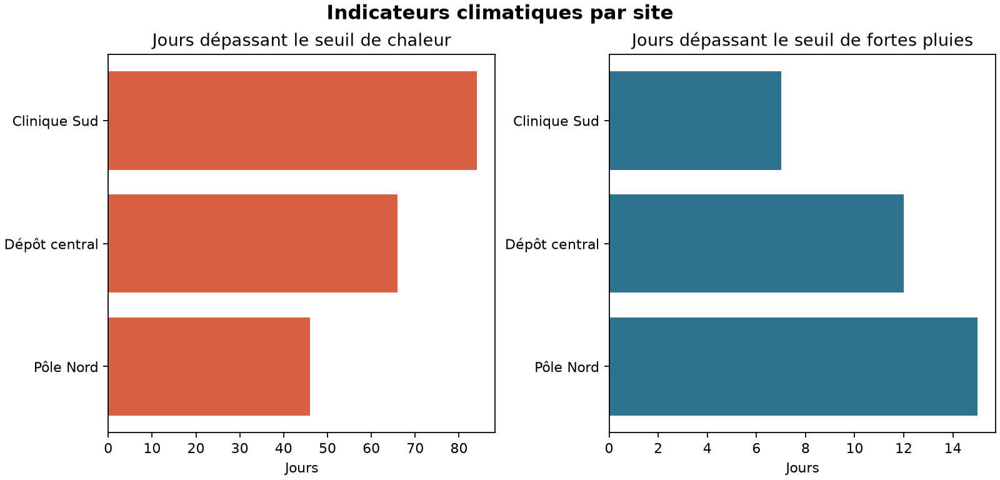

# Climate Site Risk Toolkit

[](https://www.python.org/)
[](LICENSE)

Un pipeline Python qui transforme des données climatiques maillées en indicateurs
d'exposition directement exploitables pour des sites géographiques.

Le projet couvre l'ensemble du cycle de traitement : contrôle des données d'entrée,
extraction spatiale, calcul d'indicateurs mensuels, production de livrables et traçabilité
de l'exécution. Il est conçu comme un outil réutilisable, testable et intégrable dans un
workflow automatisé.

## Cas d'usage

Une organisation gère plusieurs sites physiques, par exemple des établissements de santé,
des entrepôts ou des stations de terrain. Elle souhaite comparer leur exposition à la
chaleur et aux fortes précipitations à partir d'une grille climatique quotidienne.

Le pipeline associe chaque site à la cellule de grille la plus proche, puis calcule pour
chaque mois :

- la température maximale quotidienne moyenne ;
- le nombre de jours dépassant un seuil de chaleur configurable ;
- le cumul des précipitations ;
- le nombre de jours de fortes pluies ;
- le nombre de jours secs ;
- le nombre de jours franchissant au moins un seuil opérationnel.

## Résultats produits

| Fichier | Utilité |
| --- | --- |
| `site_timeseries.csv` | Série quotidienne détaillée avec la cellule sélectionnée |
| `monthly_site_indicators.csv` | Indicateurs mensuels prêts à analyser |
| `site_indicator_comparison.png` | Comparaison visuelle des sites |
| `run_summary.json` | Paramètres, période, volumes et avertissements de validation |



## Organisation du dépôt

```text
.
|-- .github/                 # Intégration continue et mises à jour automatiques
|-- docs/                    # Architecture, méthode et traçabilité
|-- src/climate_site_risk/   # Package Python installable
|-- tests/                   # Tests unitaires et test de bout en bout
|-- CONTRIBUTING.md
|-- SECURITY.md
|-- LICENSE
|-- pyproject.toml
`-- README.md
```

## Démarrage rapide

```powershell
python -m venv .venv
.\.venv\Scripts\Activate.ps1
python -m pip install -e ".[dev]"

climate-site-risk sample --output-dir sample_data
climate-site-risk validate --dataset sample_data/climate_sample.nc
climate-site-risk run `
  --dataset sample_data/climate_sample.nc `
  --sites sample_data/sites.csv `
  --output-dir outputs
```

Lancer les contrôles de qualité :

```powershell
ruff check .
mypy src
pytest
```

## Contrat des données d'entrée

Le fichier NetCDF doit fournir :

- les dimensions et coordonnées `time`, `latitude` et `longitude` ;
- les variables `tmax_c`, en degrés Celsius, et `precip_mm`, en millimètres par jour.

Le fichier CSV des sites doit contenir :

```csv
site_id,site_name,latitude,longitude
SITE_A,Pôle Nord,44.20,3.25
```

## Choix de conception

- La structure `src/` sépare le package installable des fichiers du dépôt.
- Les seuils sont des paramètres explicites et non des constantes cachées.
- La validation s'arrête rapidement avec des messages exploitables.
- Les résultats de synthèse sont séparés des séries temporelles détaillées.
- La CI vérifie automatiquement le style, le typage et les tests sur plusieurs versions de Python.

Consultez [l'architecture](docs/ARCHITECTURE.md),
[la méthodologie](docs/METHODOLOGY.md) et
[la traçabilité](docs/PROVENANCE.md) pour comprendre les décisions du projet.

## Données et reproductibilité

Un jeu d'exemple généré localement est fourni pour exécuter le pipeline de bout en bout sans
redistribuer de données tierces. Il sert uniquement à vérifier le fonctionnement de l'outil ;
les résultats associés ne constituent ni des observations ni des projections climatiques.

Le dépôt est une implémentation indépendante. Il ne contient aucun code, aucune donnée ni
aucun résultat provenant du CIRAD, de BRIO ou d'ARBOCARTO. Les détails sont consignés dans
le document de [traçabilité](docs/PROVENANCE.md).

## Limites

L'extraction de la cellule la plus proche ne remplace ni les observations locales, ni la
correction des biais, ni l'analyse des incertitudes, ni une modélisation d'impact propre au
domaine étudié.

## English summary

Climate Site Risk Toolkit converts gridded climate data into transparent, decision-ready
indicators for physical sites. It includes validation, spatial extraction, automated tests,
technical documentation, reporting, and continuous integration.

## Licence

Ce projet est distribué sous licence MIT.

