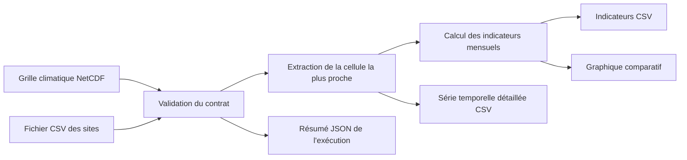

# Architecture

## Objectif

Transformer des observations climatiques quotidiennes maillées en tableaux de synthèse
et exploitables pour une liste de sites, tout en conservant une série temporelle détaillée
et traçable.

## Modules

| Module | Responsabilité |
| --- | --- |
| `sample_data.py` | Générer un jeu d'entrée reproductible |
| `validation.py` | Valider les contrats du NetCDF et du tableau des sites |
| `extraction.py` | Associer chaque site à la cellule de grille la plus proche |
| `indicators.py` | Calculer des indicateurs mensuels transparents |
| `reporting.py` | Produire un graphique et les métadonnées d'exécution |
| `pipeline.py` | Coordonner le cas d'usage complet |
| `cli.py` | Exposer des commandes stables aux utilisateurs |

## Séparation des responsabilités

Les calculs acceptent des structures de données en mémoire. Les opérations sur les fichiers
sont concentrées dans le pipeline et l'interface en ligne de commande. Cette séparation
facilite les tests et la réutilisation dans un notebook, une API ou une tâche planifiée.

